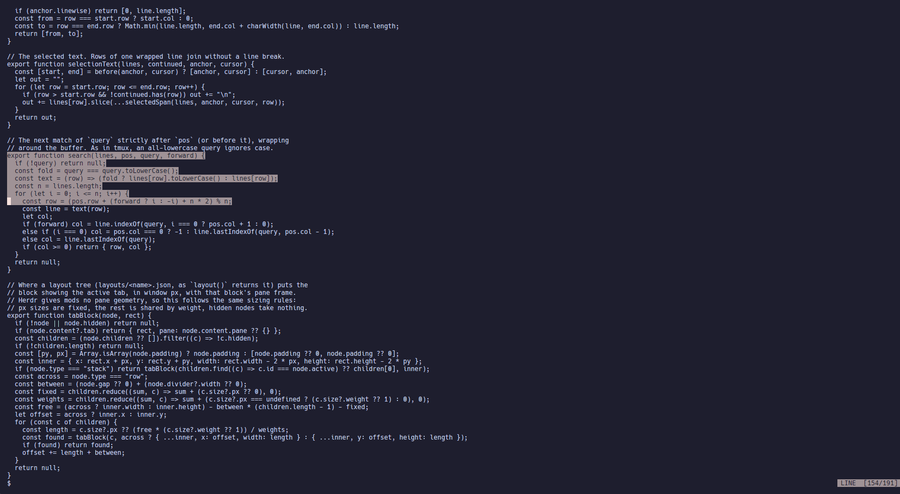

# Copy mode for Herdr

A tmux-style keyboard copy mode for the [Herdr](https://herdr.dev) desktop app. Press Ctrl+Shift+Y over a terminal, move and select with vi keys, and `y` or Enter copies to the clipboard. It works in shells and in coding agents such as Claude Code.

## Install

Ask your Herdr agent to add the mod from this repo's `copy-mode` folder, or by hand:

1. Copy `copy-mode/mods/copy-mode/` to `~/.config/herdr-app/mods/copy-mode/`.
2. Merge `copy-mode/keys.json` into `~/.config/herdr-app/keys.json`.
3. Run `herdr-app check ~/.config/herdr-app/mods/copy-mode`.

The mod runs `hc read` on the focused terminal when it opens and writes the clipboard. It reaches no network and reads no files.

## Keys

`h j k l` and arrows, `w b e`, `0 ^ $`, `g G`, `H M L`, Ctrl+U/D, Ctrl+B/F and PageUp/PageDown move. `/` and `?` search, `n N` repeat. `v` or Space starts a selection, `V` a line selection, `o` swaps ends. `y` or Enter copies and closes. `q`, Esc or a click closes.

[`copy-mode/RECIPE.md`](copy-mode/RECIPE.md) has the full behaviour and how it is built.

## Remove

Delete `~/.config/herdr-app/mods/copy-mode/` and the `ctrl-shift-y` line from `keys.json`.

## Tests

`cd copy-mode && npm test` runs the pure logic tests with node.

## License

MIT. See [LICENSE](LICENSE).
