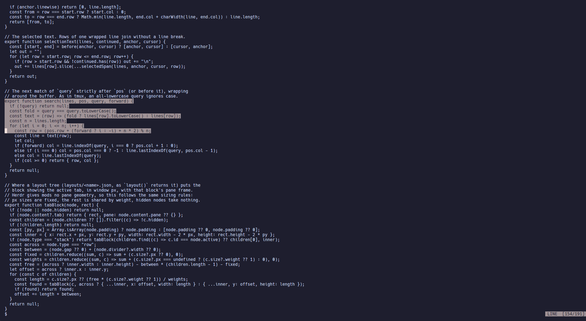

# Copy mode

A tmux-style keyboard copy mode for Herdr. One key lays the focused terminal's screen and history over the pane, in the same font and place, with a block cursor on the last line of text. You move, search and select with vi keys (`mode-keys vi`), `y` or Enter copies the selection to the clipboard, and `q` leaves. It works in shells and in coding agents such as Claude Code, including full-screen ones.

## What you see

- **The text.** Copy mode covers the focused terminal's area, under its pane header, with the terminal's own text: the screen plus up to 2,000 lines of history above it. It uses the font family and size from `settings.json`, the theme's `background`, and `terminal_foreground` (or `foreground`). Rows sit on the terminal's grid, so opening it looks like the place you were. Colours are not kept. It is plain text.
- **The cursor.** One cell in the theme's `cursor` colour, with the text in it in `background`. On an empty row it is a blank cell.
- **The selection.** Selected text has the theme's `selection` colour behind it and `background` for the text.
- **The status badge.** One row high, at the bottom right, 6px padding. It reads `COPY  [row/total]` on the theme's `accent`, or `SELECT` or `LINE` on `selection` while selecting. A failed search shows `no match: <query>` instead.
- **The search prompt.** While typing a search, the whole bottom row becomes the prompt on `background`: `/query` or `?query` in `foreground`, then a one-cell cursor.

## How it behaves

It opens with the cursor on the last row with text, scrolled to the bottom. Keys:

| Keys | Action |
|---|---|
| `h` `j` `k` `l`, arrows | Move a character or a row. Vertical moves keep the column you wanted. |
| `w` `b` `e` | Next word start, word start, word end (vi rules; punctuation is its own word; an empty line counts as one). |
| `0` `^` `$` | Line start, first non-blank, line end. |
| `g` `G` | Top of history, bottom. |
| `H` `M` `L` | Top, middle, bottom row of the view. |
| Ctrl+U, Ctrl+D | Half a page up or down, scrolling the view with the cursor. |
| Ctrl+B, Ctrl+F, PageUp, PageDown | A full page. |
| `/` `?` then Enter | Search forward or backward. A lowercase query ignores case. The search wraps around. Backspace edits, Esc or Backspace on an empty query cancels. |
| `n` `N` | Repeat the search, same or opposite direction. |
| `v` or Space | Start a character selection from the cursor. `v` again ends it. |
| `V` | Start a line selection. `V` again ends it. |
| `o` | Swap the cursor to the selection's other end. |
| `y` or Enter | Copy the selection and close. With no selection, copy the cursor's whole line. |
| Esc | Clear the selection; with none, close. |
| `q` | Close without copying. |
| Click | Close without copying. |

- **Agents.** In a working agent Herdr hands over only the screen; when the agent is idle or done, the history comes too. Claude Code's fullscreen mode (`"tui": "fullscreen"`) keeps no history in the terminal, the same as in tmux; Herdr stitches it together by scrolling the agent's own view. That can take a few seconds the first time, so copy mode opens on the screen at once and adds the history above when it arrives, keeping the cursor and selection on the same lines.
- **Long lines.** A line wider than the terminal shows on several rows, as on the screen. `y` on any of them copies the whole line, and a selection across those rows joins them without a line break.
- **Closing** gives keyboard focus back to the terminal.

## Built from

- **`mods/copy-mode/mod.json`.** `{ "place": "none", "title": "Copy mode", "overlay": { "kind": "window", "width": 1, "height": 1, "frame": "none" } }`: a frameless overlay over the whole window, drawn transparent except for the terminal's area.
- **`mods/copy-mode/main.js`.** The `CopyMode` view: a `KEYS` table from keystroke (`"ctrl-u"`, `"pagedown"`) or typed character (`"G"`, `"$"`) to an action, the selection as one nullable anchor `{ row, col, linewise }`, and the drawing. It renders only the visible rows.
- **`mods/copy-mode/motion.js`.** Pure logic with no Herdr imports, tested by node: word motions, `clamp`, `wrap` and `wholeLine`, `selectedSpan` and `selectionText`, `search`, and `tabBlock`, which finds the active tab's block in `layout()`.
- **`herdr` functions.** `focused()`, `terminals()` (the terminal's `rows` and `cols`), `panes()`, `layout()`, `settings()`, `theme()`, `props()`, `closeOverlay()` and `hc()`.
- **gpui-kit.** `View`, `div`, `h_flex` from `gpui-base`, `cx.focus_handle()`, `cx.spawn()`, `cx.write_to_clipboard()`, `cx.bind_keys()`, `on_key_down`, `on_action`, `on_size_change`, `key_context("CopyMode")`.
- **The program it runs.** `hc read <terminal> --json --lines 2000`, once per open, on the focused terminal. It reaches no network and reads no files.
- **`keys.json`.** `"global": { "ctrl-shift-y": "mod.open:copy-mode" }`. `mod.open` toggles, so the same key also closes it. To open it the tmux way from a prefix mod, map `[` to `["mod.open", { name: "copy-mode" }]`.

## Watch out

- **A popup has no height** (measured 1900×0), so copy mode is a full-window overlay that draws only over the terminal.
- **Herdr gives mods no pane geometry.** `tabBlock` follows the layout's sizing rules: `px` sizes are fixed, the rest is shared by `weight`, `gap` and `divider.width` sit between children, `padding` is inset, hidden nodes take nothing, a `stack` shows its `active` child. Inside the block, a framed pane loses its border and a header that is not `reveal: "hover"`. The grid starts at `terminal_padding`'s horizontal value and is centred between the vertical ones. These rules were measured on Herdr 0.1.15 (within 2px over 232 columns) and not re-measured since; an update could shift them by a few px.
- **Cells are whole pixels.** Herdr rounds cell width to whole px, so a font's own advance (Hack 12: 7.22px) is wider than the grid (7px). The view measures the advance once from a drawn string of 100 zeros and scales the text size to the grid. Without that, full-width lines clip. The first open after a start draws one empty frame while it measures.
- **Split tabs.** With more than one pane and none zoomed, the text covers the whole tab and does not sit on the pane's grid.
- **Ctrl+B.** A global `ctrl-b` in keys.json (such as a tmux-style prefix) would take the key. `cx.bind_keys` in the `CopyMode` key context outranks it, so Ctrl+B pages up as in tmux.
- **Closing from outside.** `overlay.close {id: "copy-mode"}` answers ok but leaves it open. `mod.open {name: "copy-mode"}` closes it.
- **History.** `hc read` returns at most 1,000 lines of history from a full-screen app, and only the screen while an agent is working.
- **Limits.** No colours, no live updates while open, no counts (`5j`), no rectangle selection, no regex search, no highlight of all matches, and a match that spans a wrapped row is missed. Wide characters (CJK, emoji) can shift columns.

## Done when

1. `herdr-app check mods/copy-mode` passes, and `npm test` in this folder passes 9 of 9.
2. In a shell that printed `line 1 …` to `line 3000 …`, opening copy mode shows the cursor on the prompt row and `COPY  [n/n]`, with each row over the same row of the terminal.
3. `k k k`, Ctrl+U, `y` puts the line 34 rows above the prompt on the clipboard.
4. `/fox`, Enter, `n`, `v`, `j`, `0`, `e`, `y` copies exactly `fox\nline`.
5. `k`, `V`, `k`, `k`, `y` copies three whole lines joined by `\n`.
6. `k`, `v`, `l`, `q` leaves the clipboard unchanged, and typing after it reaches the terminal.
7. In an idle Claude Code agent that printed 150 numbered rows, `/row 2 alpha`, Enter, `V`, `j`, `j`, `y` copies rows 2 to 4, far above the screen, and the agent's prompt stays empty.
8. Holding `j` (50 presses back to back) drops no press.
